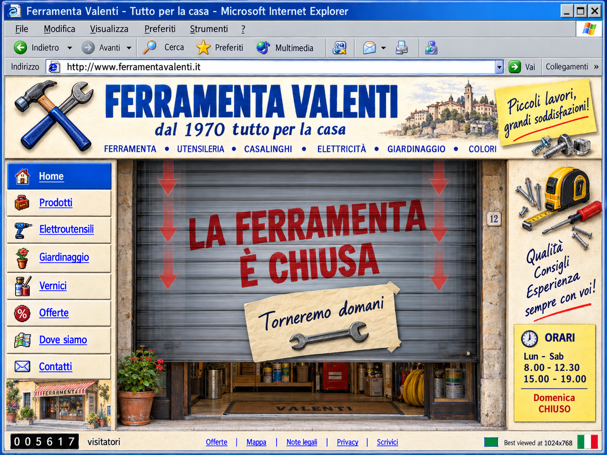

# TORNO SUBITO

> **Internet non dovrebbe chiudere. Questo sito lo fa.**

Pensavi fosse una leggenda metropolitana, una barzelletta da vecchi forum dei primi anni 2000.

La storiella del bottegaio di paese e del figlio ragazzino che, dovendo fare il sito della ferramenta di famiglia, ci schiaffò dentro gli orari del negozio fisico: alle 12:30 pausa pranzo, alle 19:00 saracinesca abbassata, la domenica chiuso per riposo settimanale. 

Tutti ridevano: *«Ma che idiota, Internet non chiude mai!»*

E invece gli idioti siamo noi.

Noi che abbiamo trasformato le nostre vite in un supermercato h24 illuminato al neon, dove se non puoi ordinare qualcosa alle tre di notte o scorrere un feed all'infinito ti viene l'ansia. Ci siamo fatti lobotomizzare dall'idea che essere sempre connessi, sempre disponibili, sempre pronti a consumare fosse una conquista, anziché una condanna.

Quel sito non era un errore d'ingenuità. Era un reperto archeologico arrivato dal futuro.  
Ed è **ancora online adesso**.

Sopravvissuto come un fossile intatto, continua a fare l'unica cosa davvero rivoluzionaria rimasta sul web: **rifiutarsi di servirti**.

Non ci credi? Vacci adesso:  
👉 **https://emaf205.com/ideas/torno-subito/**

Vacci all'ora di pranzo. Vacci a mezzanotte. Vacci di domenica.  
Troverai la saracinesca sbarrata in faccia. Niente carrello, niente swipe, niente scuse.  
Se ci entri alle 18:59, la vedi scendere mentre sei dentro, come a dirti: *spegni questo schermo e vai a vivere.*

Se perfino una macchina ha il buonsenso di fermarsi, tu quand'è l'ultima volta che hai avuto il coraggio di farlo?

---

### Documentazione dell'opera

- [Concept](docs/CONCEPT.md)
- [Artist Statement](docs/ARTIST-STATEMENT.md)
- [Project Notes](docs/PROJECT.md)
- [Stati dell'opera e orari](docs/STATES.md)
- [Note](docs/NOTE.md)

---

Opera di **EmaF205**  
Licenza: [CC BY-NC-ND 4.0](LICENSE)
